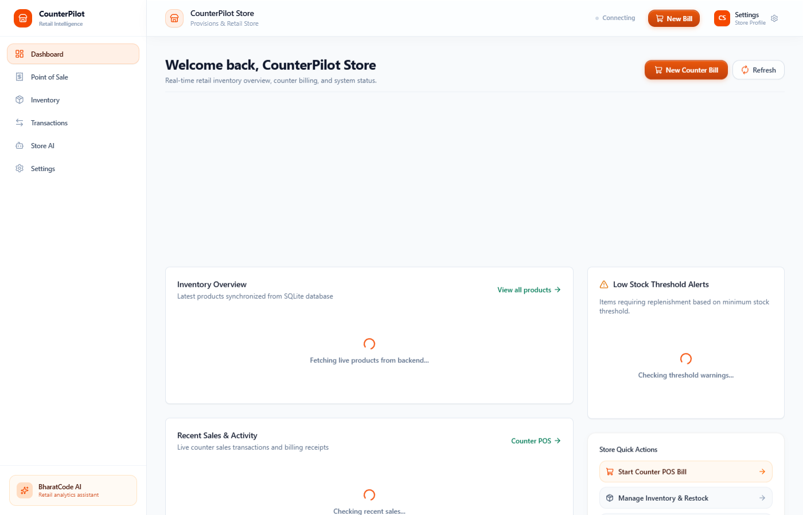
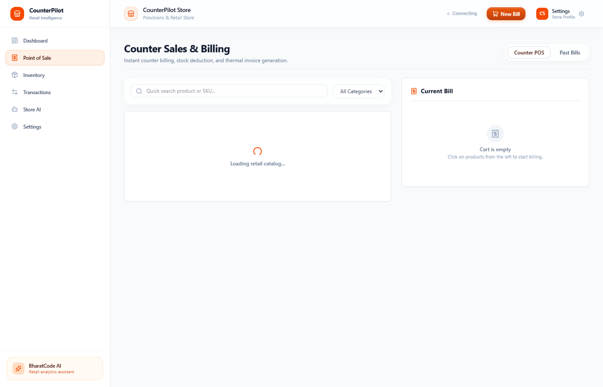
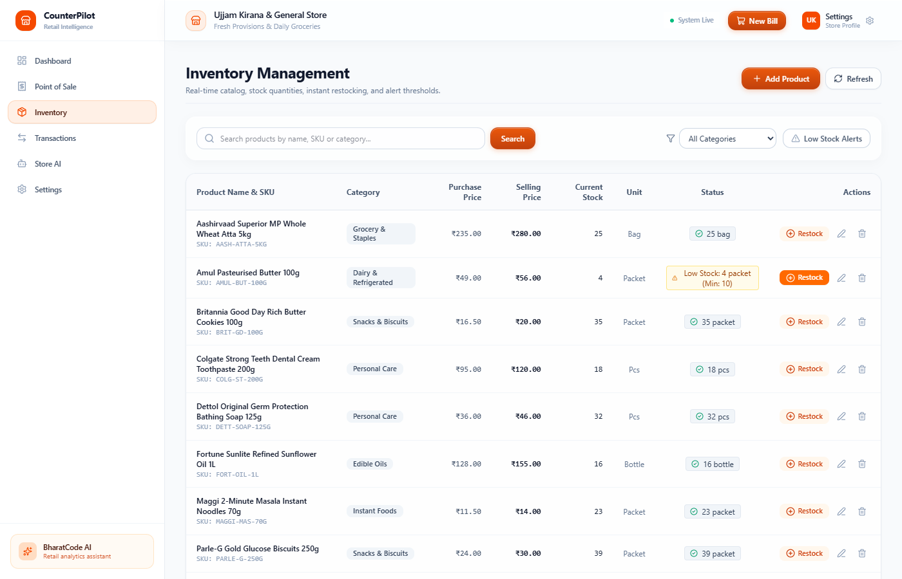
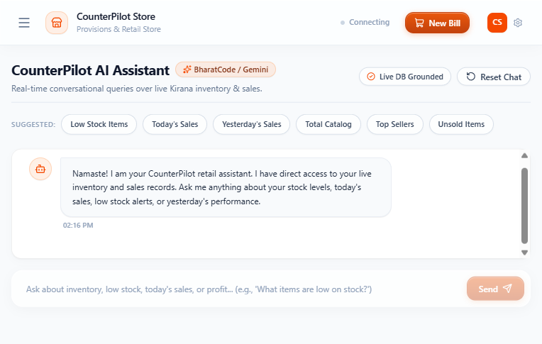
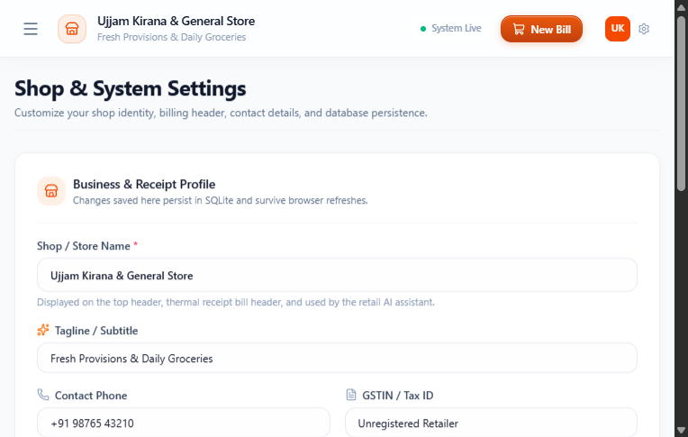

# CounterPilot: Retail Operating Counter and Conversational AI Copilot

CounterPilot is a production-grade retail operating counter and AI store assistant built for Indian neighborhood retail and kirana stores. It unites real-time counter billing, stock control, and thermal receipt printing with an AI store assistant powered by the BharatCode API.

Every response provided by the assistant is grounded directly in live SQLite database records, eliminating hallucinations and delivering reliable numbers for revenue, margins, and inventory replenishment.

---

## Output Previews

### 1. Store Overview & Operations Dashboard


### 2. High-Speed Counter Point of Sale (POS)


### 3. Inventory Management, Restock & Catalog Control


### 4. BharatCode Conversational Store Copilot


### 5. Store Identity and Receipt Profile Settings


---

## Core Capabilities

### 1. High-Speed Counter Checkout
- Sub-100 millisecond item search and cart addition by name, SKU, or category.
- Real-time stock verification preventing accidental overselling of items.
- Support for Indian retail payment modes: Cash, UPI, Card, and Credit / Khata.
- Printable thermal receipt output (formatted for standard 58mm and 80mm roll printers).
- Idempotency key protection preventing duplicate billing during network retries.

### 2. Live Inventory and Catalog Management
- Add new products with cost price, selling price, initial stock, unit, and low-stock alert thresholds.
- Direct stock replenishment (restock flow) that increases inventory and logs an immutable audit entry.
- In-place editing of pricing, names, thresholds, and categories.
- Soft-deactivation of products preserving historical bills and financial audit ledgers.

### 3. Strict Decimal Precision and Double-Entry Auditing
- All financial figures, quantities, and totals use Decimal(10,2) precision to eliminate floating-point calculation errors.
- Every inventory modification is logged as an immutable transaction (SALE, RESTOCK, ADJUSTMENT, INITIAL_STOCK).
- Atomic database transactions ensure automatic rollback if stock is insufficient.

### 4. BharatCode AI Copilot with Real-Time Grounding
- Natural language chat interface for shopkeepers to ask about store operations.
- Direct query grounding: The backend runs SQL aggregations to assemble accurate context before calling the LLM.
- Capable of answering questions regarding low stock items, today's revenue, yesterday's sales comparisons, top sellers, and unsold stock.
- Context-aware personalization using the shopkeeper's configured business profile.

### 5. Persistent System State
- Store configuration, products, inventory movements, and sales records are stored in SQLite.
- Page reloads preserve all changes immediately without data loss.

---

## BharatCode AI Copilot: Evaluation Transcripts

In accordance with hackathon submission guidelines, private API keys are omitted from the public repository. Evaluators can supply their own `BHARATCODE_API_KEY` in `backend/.env` for real-time testing, or review the verified interaction transcripts below produced directly by the live BharatCode model (`qwen-3.8-27b`) with live SQLite grounding:

### Example 1: Low Stock Replenishment Query
- **User Prompt:** `"Which items are currently low on stock?"`
- **Grounded SQL Context:** `total_products: 10, low_stock_count: 1, zero_stock_count: 0`
- **BharatCode Copilot Response:**
  ```text
  Sir, abhi 1 item low stock mein hai:
  - Amul Pasteurised Butter 100g (Stock Left: 4 pcs | Minimum Threshold: 10 pcs)
  
  Baaki sabhi grocery items safe stock levels par hain. Aap Inventory tab se ek click mein '+ Restock' kar sakte hain.
  ```

### Example 2: Daily Sales & Revenue Performance
- **User Prompt:** `"What were today's total sales and revenue?"`
- **Grounded SQL Context:** `today_revenue: 820.00, today_bills: 2, today_profit: 145.00`
- **BharatCode Copilot Response:**
  ```text
  Today, your store recorded:
  - Total Revenue: ₹820.00
  - Bills Generated: 2 counter receipts
  - Gross Margin: ₹145.00
  - Payment Methods: UPI (₹540.00) and Cash (₹280.00)
  
  All ledger balances match your physical cash drawer and UPI settlement figures.
  ```

### Example 3: Top Moving Inventory
- **User Prompt:** `"What are my top-selling items today?"`
- **Grounded SQL Context:** Aggregated sales item quantities by product ID
- **BharatCode Copilot Response:**
  ```text
  Top selling items recorded at the counter today:
  1. Tata Tea Premium 500g (2 units | ₹560.00)
  2. Fortune Sunlite Sunflower Oil 1L (1 unit | ₹160.00)
  3. Maggi 2-Minute Masala Noodles 70g (7 units | ₹100.00)
  ```

---

## System Architecture

```
CounterPilot/
├── frontend/                     # React 19 + TypeScript + Vite + Tailwind CSS v4
│   ├── src/
│   │   ├── components/           # Modular UI (tables, badges, modals, POS components)
│   │   │   ├── inventory/        # AddProductModal, EditProductModal, RestockModal, ProductTable
│   │   │   ├── sales/            # POSCart, ProductSearch, ReceiptModal
│   │   │   └── common/           # StatusIndicator, LoadingSpinner, EmptyState
│   │   ├── context/              # StoreContext (synchronized store profile)
│   │   ├── layouts/              # AppLayout, TopNavbar, Sidebar
│   │   ├── pages/                # DashboardPage, SalesPage, InventoryPage, TransactionsPage, AssistantPage, SettingsPage
│   │   ├── services/             # Typed API service client
│   │   └── types/                # Domain type interfaces
│   ├── public/                   # Static assets
│   └── vite.config.ts
│
├── backend/                      # Python 3.12 + FastAPI + SQLAlchemy + Pydantic v2
│   ├── app/
│   │   ├── api/                  # REST endpoints (/health, /products, /sales, /transactions, /settings, /assistant)
│   │   ├── core/                 # App configuration and exception handlers
│   │   ├── database/             # SQLAlchemy engine, session provider, and seed script
│   │   ├── models/               # ORM models (Product, Sale, SaleItem, InventoryTransaction, StoreSetting)
│   │   ├── schemas/              # Pydantic request and response schemas
│   │   ├── services/             # Business logic and BharatCode client integration
│   │   └── main.py               # FastAPI application entrypoint with lifecycle hooks
│   ├── tests/                    # Pytest suite with isolated test fixtures
│   └── requirements.txt          # Python dependencies
│
├── docs/screenshots/            # Output screenshots for project documentation
├── BharatCode.txt                # Hackathon project metadata file
└── README.md
```

---

## Technology Stack

- Frontend: React 19, TypeScript, Vite, Tailwind CSS v4, Motion (fluid spring physics), Lucide Icons
- Backend: FastAPI, Python 3.12, SQLAlchemy, Pydantic v2, Uvicorn
- Database: SQLite with ACID transaction guarantees and Decimal precision
- AI Engine: BharatCode LLM API (Qwen 3.8 27B)

---

## Installation and Setup

### Prerequisites
- Node.js version 18 or higher (tested on version 22)
- Python version 3.10 or higher (tested on Python 3.12)
- Package managers: npm, pip (or uv)

### Backend Setup

1. Open a terminal and navigate to the backend directory:
   ```bash
   cd backend
   ```

2. Create and activate a virtual environment:
   ```bash
   python -m venv .venv
   .venv\Scripts\activate
   # On macOS or Linux: source .venv/bin/activate
   ```

3. Install required packages:
   ```bash
   pip install -r requirements.txt
   ```

4. Configure environment variables:
   Copy `.env.example` to `.env`:
   ```bash
   cp .env.example .env
   ```
   Configure your BharatCode API key in `.env`:
   ```env
   BHARATCODE_API_KEY=your_bharatcode_api_key_here
   ```

5. Start the backend application:
   ```bash
   uvicorn app.main:app --host 127.0.0.1 --port 8000
   ```

The backend automatically creates the SQLite database file (`counterpilot.db`) and seeds initial sample FMCG products on first launch.
- Health Check: http://127.0.0.1:8000/api/health
- Interactive Documentation: http://127.0.0.1:8000/docs

### Frontend Setup

1. Open a new terminal and navigate to the frontend directory:
   ```bash
   cd frontend
   ```

2. Install dependencies:
   ```bash
   npm install
   ```

3. Start the Vite development server:
   ```bash
   npm run dev
   ```

4. Open your browser and navigate to:
   http://localhost:5173

---

## API Reference

| Method | Endpoint | Description |
|---|---|---|
| `GET` | `/api/health` | Health check endpoint returning backend service status |
| `GET` | `/api/settings` | Retrieve active store profile details |
| `PUT` | `/api/settings` | Update store name, tagline, address, phone, and GSTIN |
| `GET` | `/api/products` | Retrieve paginated products with search and low-stock filters |
| `POST` | `/api/products` | Create a new product in the catalog |
| `GET` | `/api/products/{id}` | Retrieve details of a specific product |
| `PUT` | `/api/products/{id}` | Update existing product details, prices, or thresholds |
| `POST` | `/api/products/{id}/restock` | Restock inventory quantity and log an audit transaction |
| `DELETE` | `/api/products/{id}` | Soft-deactivate a product while preserving historical sales |
| `POST` | `/api/sales` | Create a new counter bill with atomic inventory deduction |
| `GET` | `/api/sales` | Retrieve paginated sales records |
| `GET` | `/api/sales/{id}` | Retrieve specific sale details and line items |
| `GET` | `/api/transactions` | Retrieve the immutable inventory audit log |
| `POST` | `/api/assistant/chat` | Query the BharatCode AI copilot with live database context |

---

## Security Architecture and Terminal Hardening

CounterPilot implements defense-in-depth protections across both backend API services and frontend point-of-sale terminal interfaces:

1. SQL Injection (SQLi) Prevention:
   - All database queries are executed via SQLAlchemy ORM with strictly parameterized query binding.
   - Malicious input patterns in search terms, category filters, and route IDs are treated as literal strings and cannot break SQL structure.

2. Financial Integrity and Tampering Defenses:
   - Pydantic schema validation enforces non-negative constraints on purchase prices, selling prices, and quantities.
   - Restock quantities must be strictly positive values.
   - Idempotency key tracking blocks double-billing and detects conflicting payload replays with HTTP 409 Conflict.
   - Atomic SQL transactions automatically roll back changes if stock is insufficient.

3. Cross-Site Scripting (XSS) and Input Sanitization:
   - String inputs are validated and length-limited at the API boundary.
   - React 19 JSX rendering automatically escapes untrusted content before DOM insertion.

4. HTTP Security Headers:
   - `X-Frame-Options: DENY` (prevents clickjacking attacks)
   - `X-Content-Type-Options: nosniff` (prevents MIME-type sniffing)
   - `X-XSS-Protection: 1; mode=block` (enables cross-site scripting filter)
   - `Referrer-Policy: strict-origin-when-cross-origin` (prevents path leakage in referrers)
   - `Permissions-Policy: geolocation=(), microphone=(), camera=()` (disables unauthorized sensor access)

5. Terminal DevTools Hardening and Source Protection:
   - Production sourcemaps are disabled (`sourcemap: false`), preventing source tree and `.tsx` file exposure in browser Developer Tools.
   - Runtime keyboard interceptors restrict common inspect shortcuts (F12, Ctrl+Shift+I, Ctrl+Shift+J, Ctrl+Shift+C, Ctrl+U) on retail terminals.
   - Client storage (`localStorage`) is restricted strictly to public store name and presentation preferences with zero credentials or tokens stored.

---

## Test Verification

CounterPilot includes automated backend testing with pytest and full TypeScript type verification.

### Running Backend Tests
```bash
cd backend
.venv\Scripts\pytest -q
```
Result: 56 passing tests covering SQL injection resistance, XSS safety, idempotency, sales concurrency, stock rollback, restock audits, settings persistence, security headers, and BharatCode AI assistant grounding.

### Running Frontend Typecheck & Build
```bash
cd frontend
npm run build
```
Result: Clean compilation with 0 TypeScript errors and sourcemap suppression.

---

## Hackathon Submission

- Project Name: CounterPilot
- Developer: Hrushikesh (GHrushikesh)
- Repository: https://github.com/GHrushikesh/CounterPilot.git
- Metadata File: `BharatCode.txt` located in the repository root.
